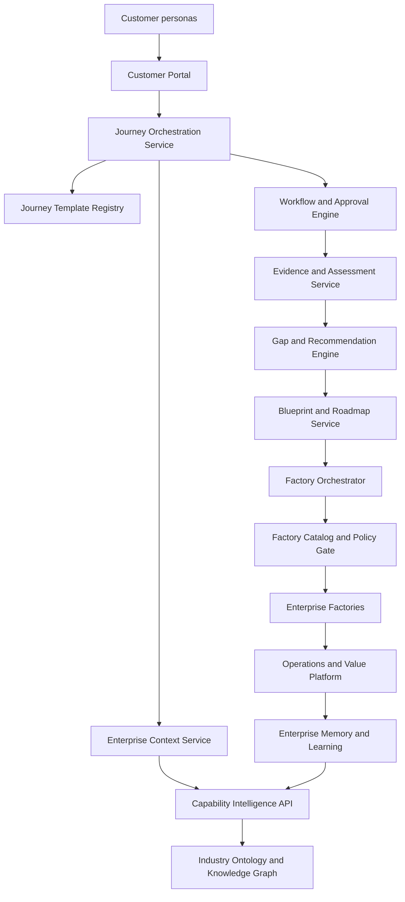

# Customer Journey Orchestration — Architecture

**Version:** 1.0.0 | **Pattern:** Domain-oriented workflow orchestration with event-driven integrations.

## Logical architecture
1. **Customer experience:** enterprise workspace, journey navigator, assessment studio, evidence manager, blueprint explorer, factory catalog and value cockpit.
2. **Journey orchestration:** template resolver, context manager, workflow/state machine, rules and decision service, task assignment, approvals, notifications and progress.
3. **Enterprise intelligence:** industry taxonomy, capability ontology, knowledge graph, assessment intelligence, process intelligence, recommendations and enterprise memory.
4. **Factory orchestration:** factory catalog, dependency resolver, policy gate, activation controller and execution adapters.
5. **Enterprise systems:** identity provider, HR/ERP/CRM/ITSM, data platforms, cloud platforms, CI/CD, observability and financial systems.

## Context and component flow

## Journey state machine
Draft → Discovering → Assessing → Diagnosing → Designing → AwaitingBlueprintApproval → Configuring → AwaitingActivationApproval → Executing → Operating → Optimizing → Closed (reopenable).

Stage transitions are guarded by required tasks, evidence, approvals and policy checks. A stage may be blocked, waived with rationale or returned for remediation. Re-entry to Assess/Diagnose creates a new version; approved baselines are never overwritten. Factory activation and production changes require explicit authorized approval. Every transition emits a domain event and audit record.

## Service boundaries
| Service | Responsibility |
|---|---|
| Journey API | Lifecycle, stage state, task assignment, progress |
| Template Registry | Versioned industry/mode/scope templates |
| Enterprise Context | Tenant, hierarchy, business unit, geography, outcomes |
| Capability Intelligence | Resolve industry/capability IDs, graph traversal, impact queries |
| Assessment & Evidence | Dimensions, scoring, evidence metadata, review and approval |
| Opportunity Engine | Gap analysis, prioritization, dependency and confidence |
| Blueprint Service | Target operating model and architecture composition |
| Factory Orchestrator | Factory selection, dependency validation, activation |
| Value Service | KPI baselines, targets, observations, benefits and attribution |
| Audit & Policy | RBAC/ABAC, approvals, policy evaluation and immutable events |

## API outline
- POST /v1/enterprises — create enterprise workspace.
- POST /v1/enterprises/{enterpriseId}/business-units — create business unit.
- GET /v1/industries — list canonical taxonomy.
- GET /v1/industries/{industryId}/capabilities?level=L1|L2|L3 — resolve capability model.
- POST /v1/journeys — instantiate journey template.
- GET /v1/journeys/{journeyId} — state and progress.
- POST /v1/journeys/{journeyId}/stages/{stageId}/evidence — attach evidence metadata.
- POST /v1/journeys/{journeyId}/assessments — submit assessment.
- POST /v1/journeys/{journeyId}/opportunities — record/approve opportunity.
- POST /v1/journeys/{journeyId}/blueprints — create blueprint version.
- POST /v1/journeys/{journeyId}/factory-activations — request activation (approval-gated).
- POST /v1/journeys/{journeyId}/kpi-observations — record actual measurement.
- GET /v1/journeys/{journeyId}/export — export approved journey state.

## Event vocabulary
EnterpriseCreated, BusinessUnitCreated, JourneyInstantiated, StageStarted, EvidenceAttached, AssessmentSubmitted, AssessmentApproved, GapIdentified, OpportunityPrioritized, BlueprintGenerated, BlueprintApproved, FactoryActivationRequested, FactoryActivationApproved, FactoryActivated, InitiativeCompleted, KPIObserved, BenefitVerified, OptimizationTriggered.

Events include tenant, aggregate, event ID, timestamp, actor, correlation ID, schema version and provenance references. Avoid sensitive payloads in event envelopes.

## Ontology and graph integration
Use canonical industry and capability IDs from the ForceMax knowledge base. The current seed graph contains source-backed hierarchy and industry applicability; applicability edges are unassessed. Do not infer equivalence, dependency, specialization or regulatory obligation edges without evidence and governance. Journey-specific relations (assesses, targets, implemented-by, measured-by) require governed extension vocabularies, provenance and approval.

## Security and resilience
OIDC/OAuth2; tenant-scoped RBAC/ABAC; separate customer evidence storage from shared reference data; encryption and KMS-backed keys; secrets manager; private networking; fine-grained evidence access; audit logging; human approval for assessment sign-off, blueprint approval, factory activation and production deployment. Use stateless APIs/workers, transactional journey storage, object storage for evidence, event bus for lifecycle events and graph/search infrastructure for knowledge. Support multi-zone deployment, backups, restore tests, idempotent consumers, dead-letter queues and tenant-specific RTO/RPO.

## Implementation sequence
- P0: domain model, template registry, enterprise context, journey CRUD, state machine and audit.
- P1: capability graph adapter, assessment/evidence, gap and opportunity services.
- P2: blueprint composition, approvals, factory catalog and activation simulation.
- P3: execution integrations, KPI/value tracking and continuous optimization.
- P4: AI-assisted recommendations, enterprise memory learning and multi-industry template governance.
